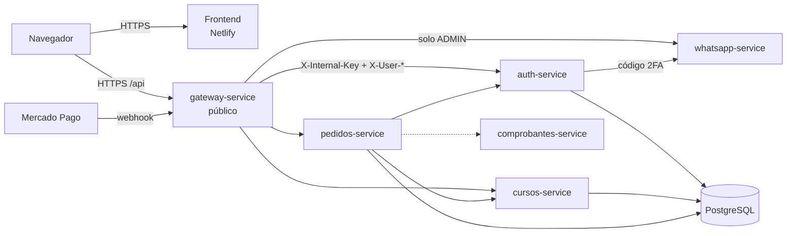

# Guía de despliegue: un servidor por microservicio

Cada servicio es una imagen Docker independiente y se configura solo con variables de entorno,
así que puede vivir en un servidor, región o proveedor distinto. Solo el **gateway** y el
**frontend** se exponen a Internet.



## 1. Seguridad por niveles

| Capa | Dónde | Qué hace |
| --- | --- | --- |
| 0. Cabeceras | gateway | `X-Content-Type-Options`, `X-Frame-Options`, CSP, HSTS (detrás de HTTPS), `X-Request-Id` |
| 1. IP | gateway | Lista negra fija (`SECURITY_BLOCKED_IPS`), rate limit por minuto (general y de login), bloqueo automático 15 min tras 5 logins fallidos o abuso reiterado, bloqueo manual desde el panel ADMIN |
| 2. CORS | gateway | Solo los orígenes exactos de `CORS_ALLOWED_ORIGINS`; preflight de otros orígenes → 403 |
| 3. JWT | gateway | HS256 verificado, expiración, secreto ≥ 32 caracteres |
| 4. Roles | gateway (`AccessPolicy`) | Público → Estudiante → Docente → Admin; rutas internas bloqueadas; rutas no listadas rechazadas (fail closed); el usuario solo accede a sus propios datos |
| 5. Clave interna | cada servicio | Rechaza todo lo que no traiga `X-Internal-Key` (nadie puede saltarse el gateway aunque el servicio tenga URL propia) |
| 6. Cuenta y 2FA | auth-service | BCrypt, bloqueo de cuenta 15 min tras 5 contraseñas incorrectas, código WhatsApp de 5 min con máximo 5 intentos, docentes y admin con 2FA obligatorio, registro público solo como estudiante |
| 7. Datos | cursos / pedidos | Docente solo edita sus cursos; estudiante solo ve y cancela sus pedidos; bloqueo de fila contra sobreventa; reservas vencidas se liberan solas |

Matriz de acceso completa: `gateway-service/src/main/java/com/curso/gateway/security/AccessPolicy.java`.

## 2. Variables por servicio

Genere los secretos una sola vez y use **los mismos** valores en todos los servicios:

```bash
openssl rand -base64 48   # JWT_SECRET
openssl rand -base64 48   # INTERNAL_API_KEY
```

| Variable | gateway | auth | cursos | pedidos | whatsapp | comprobantes |
| --- | :-: | :-: | :-: | :-: | :-: | :-: |
| `SPRING_PROFILES_ACTIVE=prod` | ✓ | ✓ | ✓ | ✓ | | |
| `JWT_SECRET` | ✓ | ✓ | | | | |
| `INTERNAL_API_KEY` | ✓ | ✓ | ✓ | ✓ | ✓ | ✓ |
| `SPRING_DATASOURCE_URL` / `_USERNAME` / `_PASSWORD` | | ✓ | ✓ | ✓ | | |
| `AUTH_SERVICE_URL` | ✓ | | | ✓ | | |
| `CURSOS_SERVICE_URL` | ✓ | | | ✓ | | |
| `PEDIDOS_SERVICE_URL` | ✓ | | | | | |
| `WHATSAPP_SERVICE_URL` | ✓ | ✓ | | | | |
| `CORS_ALLOWED_ORIGINS` | ✓ | | | | | |
| `SECURITY_TRUSTED_PROXIES` | ✓ | | | | | |
| `MERCADOPAGO_ACCESS_TOKEN`, `FRONTEND_URL`, `MERCADOPAGO_NOTIFICATION_URL` | | | | ✓ | | |
| `SMTP_*` | | | | | | ✓ |

Con el perfil `prod` los servicios **no arrancan** si falta un secreto: no hay valores por defecto inseguros.
Plantilla completa: `.env.example`.

`SECURITY_TRUSTED_PROXIES`: rango del balanceador del proveedor, para leer la IP real del cliente.
Si lo deja vacío detrás de un balanceador, todas las visitas parecerán venir de la misma IP y el rate limit las bloquearía juntas.

## 3. Construir las imágenes

Los servicios Java se construyen desde la raíz (necesitan el `pom.xml` padre):

```bash
docker build -f gateway-service/Dockerfile -t gateway-service .
docker build -f auth-service/Dockerfile    -t auth-service .
docker build -f cursos-service/Dockerfile  -t cursos-service .
docker build -f pedidos-service/Dockerfile -t pedidos-service .
docker build -t whatsapp-service     whatsapp-service
docker build -t comprobantes-service comprobantes-service
```

Todo junto en una máquina (demo): `cp .env.example .env && docker compose up --build`
→ frontend en http://localhost:8088, API en http://localhost:8080.

## 4. Opción recomendada: Azure for Students (≈ US$ 0–10/mes)

Detalle de costos en la matriz comparativa del curso.

1. **PostgreSQL**: Azure Database for PostgreSQL Flexible Server **B1ms** (gratis 12 meses), región Brazil South.
   Cree la base `cursos_db` y ejecute `database/schema_local.sql`.
2. **Registro de imágenes**: Azure Container Registry; suba las 6 imágenes.
3. **Container Apps** (un *Container App* por servicio, mismo *environment*):
   - `gateway-service`: ingress **externo**, puerto 8080.
   - `auth`, `cursos`, `pedidos`, `comprobantes`: ingress **interno** (solo visibles dentro del environment).
   - URLs internas: `https://<app>.internal.<environment-domain>`; úselas en `*_SERVICE_URL`.
   - Health probe: `/actuator/health` (Java) o `/health` (Python).
4. **whatsapp-service**: VM Linux **B1s** (gratis 12 meses) con Docker y volumen `/data`.
   Primera vez: `docker logs -f whatsapp-service` y escanee el QR con el WhatsApp del negocio.
   Abra el puerto 8085 solo para la red de Container Apps.
5. **Frontend**: Netlify (ver `frontend/README.md`) con `VITE_API_URL` = URL del gateway.
6. **Mercado Pago**: `MERCADOPAGO_NOTIFICATION_URL=https://<gateway>/api/pedidos/webhook`.

### Otros proveedores

| Proveedor | Público | Interno | Notas |
| --- | --- | --- | --- |
| Google Cloud Run | gateway con `--allow-unauthenticated` | resto con ingress `internal` | WhatsApp necesita `--min-instances=1` y su sesión se pierde al reiniciar: mejor en una VM |
| Render | gateway como Web Service | resto como Private Services | WhatsApp en plan Standard con disco montado en `/data` |
| Railway | gateway con dominio público | resto sin dominio, red privada `*.railway.internal` | Volumen en `/data` para WhatsApp |
| AWS ECS Express Mode | gateway público | resto privados | El más caro para 6 servicios |

## 5. Lista de verificación antes de la entrega

- [ ] **Rotar credenciales expuestas:** el historial de Git aún contiene la contraseña de la BD y el token de prueba de Mercado Pago que estaban en `application.properties`. Cámbielos en PostgreSQL y en Mercado Pago aunque ya no estén en el código.
- [ ] `JWT_SECRET` e `INTERNAL_API_KEY` largos, aleatorios e iguales en todos los servicios.
- [ ] `CORS_ALLOWED_ORIGINS` con la URL exacta de Netlify (sin `*`).
- [ ] `SECURITY_TRUSTED_PROXIES` con el rango del balanceador.
- [ ] Solo el gateway tiene URL pública; `curl https://<auth>/api/cursos` desde fuera debe fallar.
- [ ] WhatsApp vinculado (panel ADMIN → Seguridad muestra “conectado”).
- [ ] `OTP_LOG_IF_WHATSAPP_DOWN` **no** definido en producción.
- [ ] Usuarios semilla: cambie la contraseña `Clave1234` del admin y docente.
